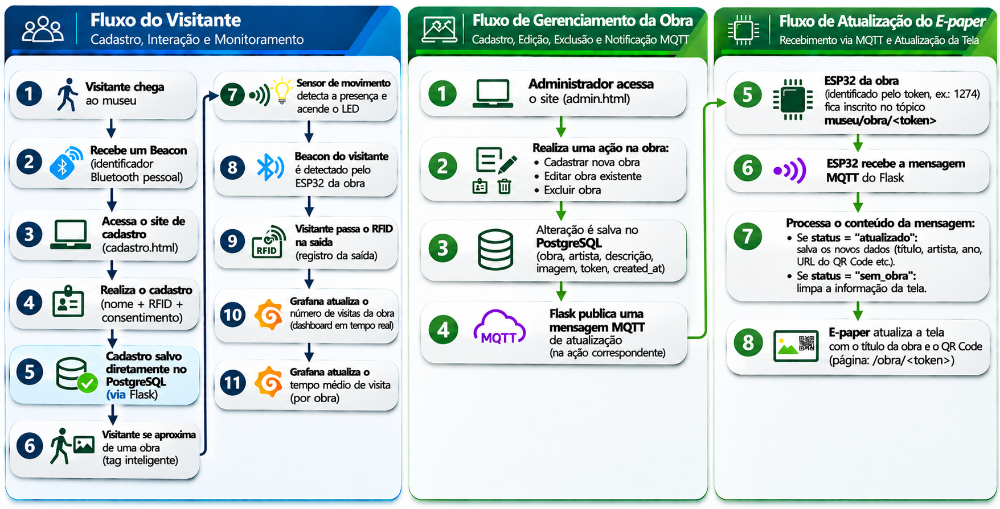

# 🏛️ <strong>Tag Inteligente de Obra</strong>

**Sistema IoT para interação e monitoramento de visitas em museus**

 

### Sobre o Projeto

O **Tag Inteligente de Obra** é um projeto baseado em **Internet das Coisas (IoT)** que busca tornar a experiência de visitação a museus mais interativa, informativa e tecnológica.

A proposta é desenvolver um sistema capaz de **identificar a aproximação de visitantes às obras de arte**, disponibilizar informações sobre elas de maneira acessível e registrar dados de visitação.

Por meio da integração entre **RFID, Beacon Bluetooth, sensores de proximidade, displays e-paper e uma plataforma web**, o projeto pretende proporcionar uma experiência mais dinâmica ao público e oferecer aos gestores do museu informações sobre o interesse dos visitantes pelas obras expostas.

 

### Funcionamento do Sistema

O sistema integra identificação de visitantes, sensores IoT e uma plataforma web em cinco etapas:

| Etapa | Funcionamento |
|:---|:---|
| **1. Cadastro** | O visitante se cadastra na plataforma e recebe uma identificação RFID. |
| **2. Aproximação** | O Beacon BLE identifica a proximidade e o sensor pode acionar um LED. |
| **3. Informações** | O display e-paper exibe o nome da obra e um QR Code com acesso a mais detalhes. |
| **4. Registro** | As interações são associadas às obras e armazenadas no banco de dados. |
| **5. Dashboard** | Os dados permitem acompanhar visitas, aproximações e obras mais acessadas. |

 

### Fluxograma do Sistema

  

 

### Tecnologias e Componentes

| Tecnologia | Função |
|:---|:---|
| **RFID** | Identificação dos visitantes |
| **Beacon Bluetooth (BLE)** | Detecção de aproximação |
| **Sensor de proximidade** | Detecção de presença próxima à obra |
| **LED** | Sinalização visual |
| **Display e-paper** | Exibição de informações e QR Code |
| **Node-RED** | Integração e automação |
| **MQTT** | Comunicação IoT |
| **Banco de dados** | Armazenamento dos registros |
| **Plataforma web** | Cadastro e consulta de informações |
| **Dashboard** | Monitoramento e análise das visitas |
| **Modelagem 3D e PCB** | Desenvolvimento físico e eletrônico |

 
